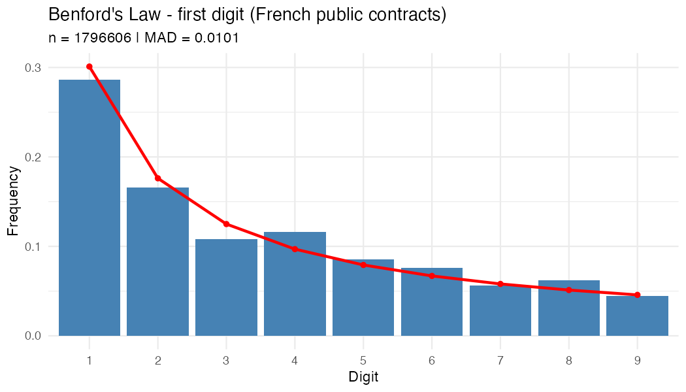
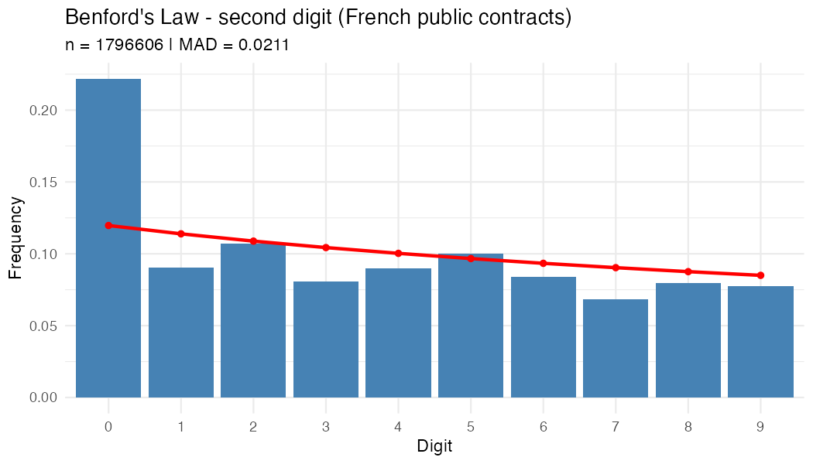

# Detecting anomalies in French public procurement with Benford's Law

## Goal
I use Benford's Law, a data-driven audit technique, to find unusual patterns in the amounts of French public contracts.

## Data
- Source: DECP (Données essentielles de la commande publique), data.gouv.fr
- Only contracts of 40,000 EUR (excl. VAT) and above are published
- After cleaning: 1,796,606 contracts

## Method
1. Remove duplicates and amounts flagged as anomalies in the dataset.
2. Extract the first and second digit of each contract amount.
3. Compare the observed frequencies with Benford's theoretical frequencies.
4. Measure the gap with the MAD (mean absolute deviation) and a chi-square test.
5. Count round amounts (multiples of 10,000 EUR) and rank buyers by their share of round amounts.

## Results
- First digit: moderate gap with Benford's Law (MAD = 0.0101).
- Second digit: larger gap (MAD = 0.0211). The digit 0 is far too frequent.
- 23.2% of contracts have an amount that is a multiple of 10,000 EUR.
- The most common amounts are 200,000, 100,000, 40,000, 80,000 and 400,000 EUR.
- Among buyers with at least 200 contracts, the top 20 have more than 70% round amounts.
- Cleaning the data (removing duplicates) did not remove the gap: the MAD was 0.0088 (first digit) and 0.0187 (second digit) before cleaning.

## Possible explanations (not tested)
- Ceiling amounts in framework agreements
- Estimated budgets instead of final prices
- Amounts set just above the 40,000 EUR publication threshold
- Purchasing agencies, where round ceiling amounts are normal

## Limits
- The 40,000 EUR threshold distorts the first digit, so the second digit is more reliable.
- With millions of rows, the chi-square test always rejects Benford's Law, so I rely on the MAD.
- **A gap with Benford's Law is a statistical signal, not proof of fraud.** A real audit would check the contract documents.

## Tools
R (tidyverse, arrow, ggplot2)

## How to run
1. Download the DECP parquet file from data.gouv.fr and save it as decp.parquet
2. Open benford_audit.R in RStudio and run it
